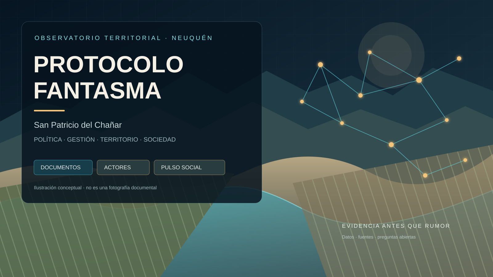

# PROTOCOLO FANTASMA — Laboratorio de investigación

> Ilustración vectorial conceptual, no fotografía documental. La aplicación principal permanece congelada mientras esta capa de investigación crece.

Este directorio contiene la capa documental del observatorio. **No modifica la estructura ni la funcionalidad de `index.html`**. Se trabaja en la rama `profundizacion-observatorio`; `base-congelada-v0.7` conserva una referencia separada.

## Índice de investigación

1. [Mapa de fuentes y protocolo de evidencia](01-mapa-de-fuentes.md)
2. [Carta Orgánica y expediente de las 42 viviendas](02-carta-organica-y-caso-42-viviendas.md)
3. [Escenario político local — octubre de 2026](03-escenario-politico-octubre-2026.md)
4. [Modelo de datos y visualizaciones](04-modelo-de-datos-y-visualizaciones.md)
5. [Finanzas, rendición de cuentas y obras](05-finanzas-rendicion-y-obras.md)
6. [Actores, conflictos y agenda pública](06-actores-conflictos-y-agenda-publica.md)
7. [Sondeo social: metodología y cuestionario](07-sondeo-social-metodologia-y-cuestionario.md)
8. [Dirección de arte y atlas visual](08-direccion-de-arte-y-atlas-visual.md)
9. [Tablero político 2027: escenarios, actores y variables](09-tablero-2027-escenarios-y-actores.md)
10. [Agenda de debates incómodos y preguntas públicas](10-agenda-de-debates-incómodos.md)
11. [Matriz de expedientes y pedidos de información](11-matriz-de-expedientes-y-pedidos-de-informacion.md)

## Qué hay que vigilar ahora

- **Radares/fotomultas:** contratos, pagos, observaciones, descargos y decisión final.
- **42 viviendas:** actas, mayorías, impugnación, ordenanza y reglas de adjudicación.
- **Centro Deportivo Comunitario:** contrato, anticipo, inicio, certificados, modificaciones y mantenimiento.
- **Tierras fiscales:** inventario, criterios, expedientes, controles y estado de actuaciones reportadas.
- **Presupuesto y rendición:** comparar aprobado, recaudado, ejecutado, pagado y avance físico.
- **Gas y servicios:** convenios, desembolsos, conexiones, rendiciones y reintegros.
- **Club San Patricio:** convenio firmado, obligaciones, uso del predio y acceso comunitario.
- **Seguridad:** cifras con período, universo, clasificación y metodología, sin estigmatizar barrios.
- **Panorama 2027:** anuncios directos, propuestas, decisiones partidarias y cronograma electoral oficial.

## Método de evidencia

- Cada afirmación debe etiquetarse como **documento oficial**, **cobertura periodística atribuida**, **declaración**, **hipótesis analítica**, **percepción social** o **dato pendiente**.
- Cada registro debe incluir fecha, fuente, enlace, emisor y estado de verificación.
- Las notas sirven para detectar pistas; las conclusiones jurídicas, presupuestarias o de ejecución requieren documentos primarios.
- No inventar índices de aprobación, temperatura social representativa ni intención de voto.
- Documentar actos públicos, decisiones y relaciones políticas públicas verificables. No presentar rumores personales como hechos.
- Registrar respuestas, descargos y correcciones con la misma visibilidad que la pregunta original.
- El estado de la evidencia califica el documento, nunca a la persona.

## Regla editorial

La agenda puede ser incisiva. Los titulares no deben afirmar más de lo que prueban los documentos. Investigar un hecho, cuestionar un procedimiento y exigir explicaciones no equivale a anticipar culpabilidad.

## Estado

Esta capa es una base de investigación en expansión, no una auditoría exhaustiva ni una determinación jurídica. No se han inventado resultados de sondeo. Los documentos y casos deben actualizarse cuando aparezcan actas, ordenanzas, decretos, expedientes, respuestas oficiales o aclaraciones posteriores.
